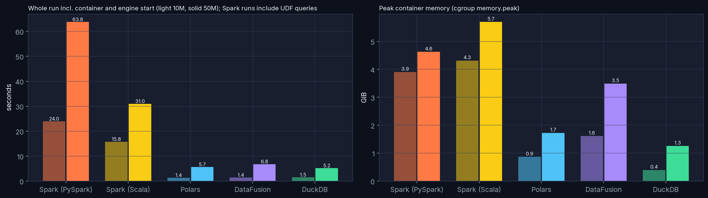
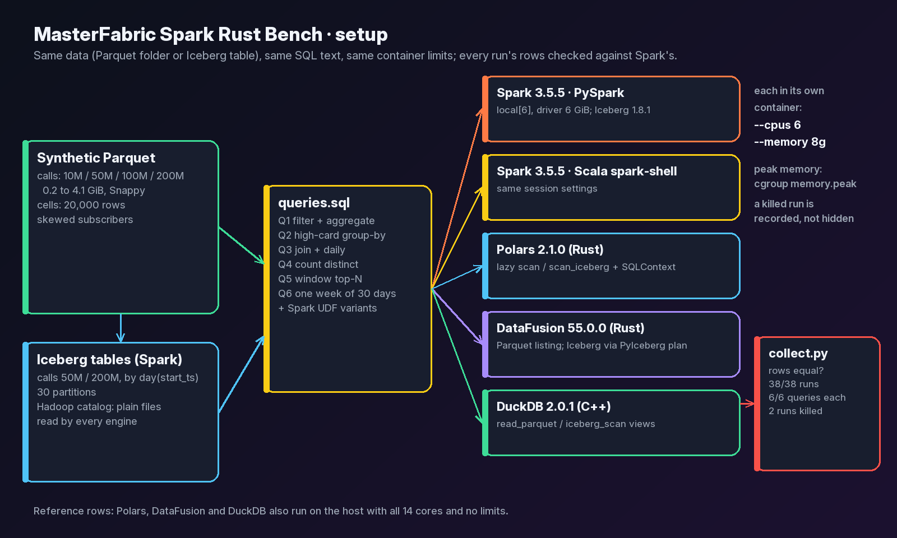
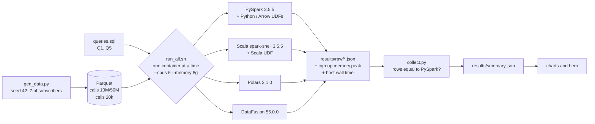

<p align="center"></p>

# MasterFabric Spark Rust Bench

The same five analytical SQL queries over the same synthetic telco call records, run by
**PySpark**, **Scala Spark**, **Polars** and **Apache DataFusion**, each alone in a container with
the same limits (6 CPU, 8 GiB). Every engine's rows are checked against Spark's before any time
counts: **60 of 60 query results are identical.**

It answers three questions an AI/data architect gets asked:

1. How much does Spark cost for jobs that fit on one machine, compared with Rust engines?
2. Is PySpark slower than Scala Spark?
3. What do UDFs cost, and which kind should a team allow?

All numbers below were measured on one Apple M4 Pro laptop (Colima VM with 6 vCPUs, 10 GiB) and
are read from [`results/summary.json`](results/summary.json).

## Results

### Per-query medians

<p align="center"></p>
<p align="center"><em>Median of three timed runs after one first run, log scale. Polars and DataFusion
lead on every query; Spark from Python and from Scala are within noise of each other.</em></p>

Median seconds at **50M rows** (1,038 MiB of Parquet):

| Query | PySpark | Scala Spark | Polars | DataFusion |
|---|---:|---:|---:|---:|
| Q1 filter + aggregate | 0.485 | 0.481 | 0.121 | 0.160 |
| Q2 high-cardinality group-by, top 100 | 0.478 | 0.549 | 0.108 | 0.187 |
| Q3 join cells + daily aggregate | 1.114 | 1.258 | 0.342 | 0.560 |
| Q4 count distinct subscribers per region | 1.272 | 1.270 | 0.309 | 0.435 |
| Q5 window top-3 cells per region | 0.382 | 0.372 | 0.086 | 0.108 |
| **Sum** | **3.731** | **3.929** | **0.966** | **1.450** |

At **10M rows** (207 MiB) the sums are 1.321 s (PySpark), 1.443 s (Scala), 0.234 s (Polars) and
0.250 s (DataFusion). Spark's first run of each query is 1.4 to 4.7 times slower than its median
(for example Q1 at 50M rows: 1.37 s first vs 0.49 s median); the Rust engines' first runs are
close to their medians except for Polars Q1 to Q3 at 50M rows.

### Whole run and memory

<p align="center"></p>
<p align="center"><em>Left: host-measured wall time for the whole container run (start, five queries
four times, and for Spark the UDF queries). Right: peak container memory from cgroup memory.peak.</em></p>

| | PySpark | Scala Spark | Polars | DataFusion |
|---|---:|---:|---:|---:|
| Peak memory, 10M rows | 3,631 MiB | 3,819 MiB | 894 MiB | 1,467 MiB |
| Peak memory, 50M rows | 3,616 MiB | 5,055 MiB | 1,766 MiB | 3,588 MiB |
| Engine start-up, in process | 2.1 s | 0.95 s (after JVM and shell) | 0.10 s | 0.06 s |
| Whole container run, 50M rows | 58.0 s * | 26.9 s * | 5.0 s | 6.1 s |

\* The Spark runs also execute their UDF variants (three for PySpark, one for Scala), so the two
Spark wall times are not comparable with each other; compare the SQL sums instead.

Reference, not part of the comparison: on the host with all 14 cores and no limits, the five
queries at 50M rows sum to 0.504 s (Polars) and 0.615 s (DataFusion).

### Spark UDFs

<p align="center"></p>
<p align="center"><em>The same revenue-tier column, computed four ways and aggregated. Median seconds.</em></p>

| Revenue tier as | 10M rows | 50M rows |
|---|---:|---:|
| Built-in `CASE WHEN` | 0.104 | 0.273 |
| Scala UDF | 0.194 | 0.661 |
| Arrow (pandas) UDF | 0.491 | 1.856 |
| Python UDF (row at a time) | 1.460 | 6.613 |

### What this means

- For jobs that fit on one machine, Polars ran the same SQL **3.9x faster than PySpark** with
  **half the memory**; DataFusion was 2.6x faster. Neither needs a JVM or a cluster.
- **PySpark SQL is as fast as Scala SQL** (3.73 s vs 3.93 s). The plan runs in the JVM either way.
- **Python UDFs are the real cost:** 24x the built-in expression at 50M rows. Arrow UDFs cut that
  to 6.8x; a Scala UDF to 2.4x.

## How it works

<p align="center"></p>
<p align="center"><em>One dataset, one SQL file, four engines in equally limited containers, one correctness gate.</em></p>



| Piece | What it does |
|---|---|
| [`bench/gen_data.py`](bench/gen_data.py) | Synthetic call records: subscriber (Zipf 1.3 over 2M IDs), cell (20,000), timestamp (30 days), data/voice/SMS, duration, MB, revenue in TRY; plus a `cells` dimension with 7 Turkish regions and technology. Snappy Parquet, 5M rows per file. |
| [`bench/queries.sql`](bench/queries.sql) | Five queries, one SQL text each, run unchanged on all engines. |
| [`bench/run_pyspark.py`](bench/run_pyspark.py) | Spark `local[6]`, 6 GiB driver, 12 shuffle partitions, UTC; plus three UDF variants. |
| [`bench/RunSpark.scala`](bench/RunSpark.scala) | The same in Scala through `spark-shell -i`, plus a Scala UDF. |
| [`bench/run_python_engine.py`](bench/run_python_engine.py) | Polars (`SQLContext` over lazy scans) and DataFusion (`SessionContext`). |
| [`bench/run_all.sh`](bench/run_all.sh) | Runs every engine in its own container, records cgroup peak memory and host wall time. |
| [`bench/collect.py`](bench/collect.py) | Builds `results/summary.json` and checks each engine's rows against PySpark's. |
| [`tests/`](tests) | Polars and DataFusion agree on all five queries; tolerance unit tests. |

Decisions are recorded as ADRs:

- [ADR 0001: How the benchmark stays fair](docs/adr/0001-benchmark-fairness.md)
- [ADR 0002: When to use Spark and when a single-node Rust engine](docs/adr/0002-spark-or-single-node-engine.md)
- [ADR 0003: Python in Spark is fine; Python UDFs are the cost](docs/adr/0003-python-udfs.md)

## Enterprise mapping

| Here | In a Cloudera / enterprise platform |
|---|---|
| Spark 3.5.5 in a container, `local[6]` | Spark on Cloudera Data Engineering (CDE) or CDP Private Cloud Base on YARN/Kubernetes, many executors |
| Parquet files in a folder | Iceberg tables on HDFS/Ozone or S3, shared by Spark, Impala and Trino (see [masterfabric-lakehouse-lab](https://github.com/masterfabric/masterfabric-lakehouse-lab)) |
| Polars / DataFusion in a container | A small-job path: containers on Kubernetes or Cloudera Data Science Workbench / CML reading the same Iceberg tables |
| `docker run --cpus --memory` | YARN queues or Kubernetes resource quotas |
| Spark UDF variants | Coding standards for CDE jobs: built-ins first, Arrow UDFs in Python, Scala for hot paths |
| Not measured: Rust inside Spark | Apache DataFusion Comet or Apache Gluten (Velox) as native Spark accelerators; Ballista for distributed DataFusion |

## Quickstart

Needs Docker (any runtime with at least 6 CPUs and 10 GiB), [uv](https://github.com/astral-sh/uv)
and about 2 GiB of disk.

```bash
git clone https://github.com/masterfabric/masterfabric-spark-rust-bench
cd masterfabric-spark-rust-bench
make venv                 # Python 3.12 + pinned requirements
make gen                  # 10M and 50M rows into data/ (about 1.2 GiB)
docker pull tabulario/spark-iceberg:3.5.5_1.8.1
make image                # Polars + DataFusion image
make bench                # all engines, both sizes, about 3 minutes here
make collect test charts  # summary.json, correctness tests, images
```

`SIZES=10m make bench` runs only the smaller size. `make clean-containers` removes any leftover
`mf-srb-*` containers if a run is interrupted.

## Limitations

- **One machine, single-node Spark.** Spark runs in `local[6]` mode, not on a cluster. The
  results say nothing about multi-node shuffles, executor failures or terabyte inputs, which is
  where Spark is built to win.
- **Warm cache.** The OS page cache holds the Parquet files after the first run; the medians
  measure compute, not storage I/O. The first-run column in `summary.json` is closer to a cold job.
- **Rust engines through Python.** Polars and DataFusion are driven from their Python bindings
  (the execution is Rust); no standalone Rust binary was benchmarked.
- **Three timed runs per query.** Enough to see 2x differences; treat gaps under about 10% as noise.
- **Synthetic, skewed data.** The distributions are made up to be realistic in shape (Zipf
  subscribers, mostly data sessions), not taken from a real network.
- **Default tuning.** Spark got sensible local settings (12 shuffle partitions, 6 GiB driver),
  not per-query tuning; adaptive query execution is on by default in 3.5. Polars and DataFusion
  ran with defaults.
- **Containers on macOS** run inside a Linux VM (Colima, 6 vCPUs), which adds some overhead to
  all engines equally.
- Comet, Gluten and Ballista are mentioned as options, not measured.

## Roadmap

- Repeat on a 3-node Spark cluster with the same queries at 500M+ rows to find the crossover point.
- Add Apache DataFusion Comet as a Spark plug-in and measure it on the same SQL.
- Read Iceberg tables instead of plain Parquet, sharing data with the lakehouse lab.
- Cold-cache runs (drop caches between runs) and more repeats.

## Related MasterFabric repositories

[lakehouse-lab](https://github.com/masterfabric/masterfabric-lakehouse-lab) ·
[realtime-telco](https://github.com/masterfabric/masterfabric-realtime-telco) ·
[airflow-mlops](https://github.com/masterfabric/masterfabric-airflow-mlops) ·
[onprem-llm-stack](https://github.com/masterfabric/masterfabric-onprem-llm-stack) ·
[llm-serving-bench](https://github.com/masterfabric/masterfabric-llm-serving-bench) ·
[secure-data-ai](https://github.com/masterfabric/masterfabric-secure-data-ai) ·
[genai-foundations](https://github.com/masterfabric/masterfabric-genai-foundations)

## License

Copyright (c) 2026 MasterFabric. Licensed under the [GNU Affero General Public License v3.0](LICENSE)
with the attribution and trademark terms in [NOTICE](NOTICE). Third-party components keep their own
licenses, listed in NOTICE. See also [CONTRIBUTING](CONTRIBUTING.md), [CODE_OF_CONDUCT](CODE_OF_CONDUCT.md)
and [SECURITY](SECURITY.md). Build history: [docs/TIMELINE.md](docs/TIMELINE.md).
