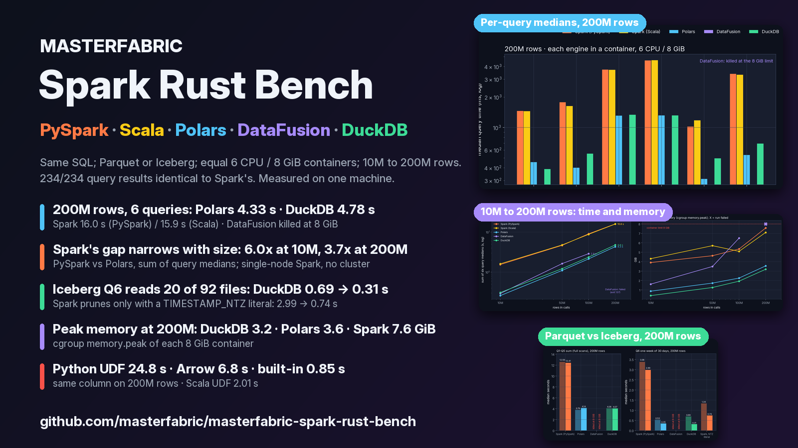
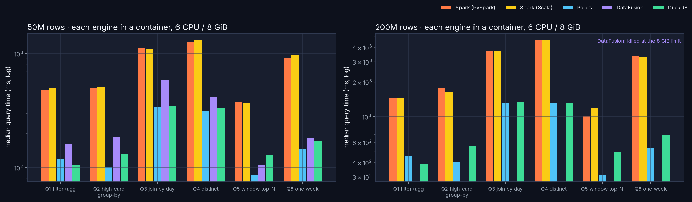
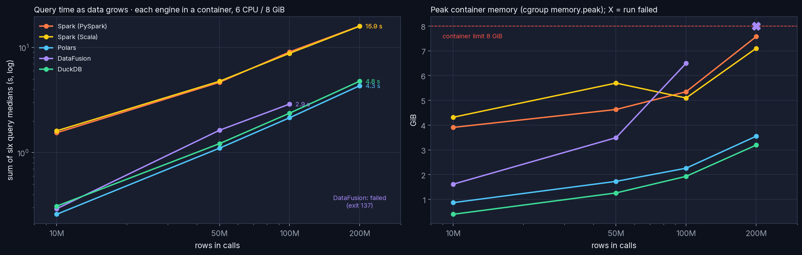
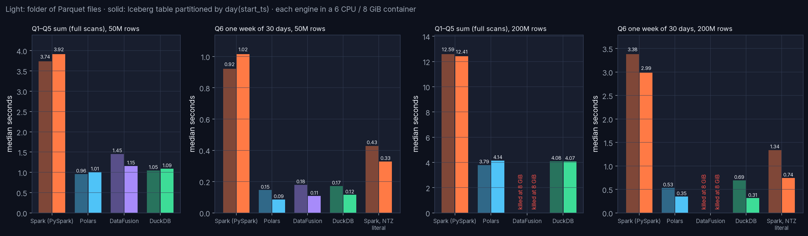
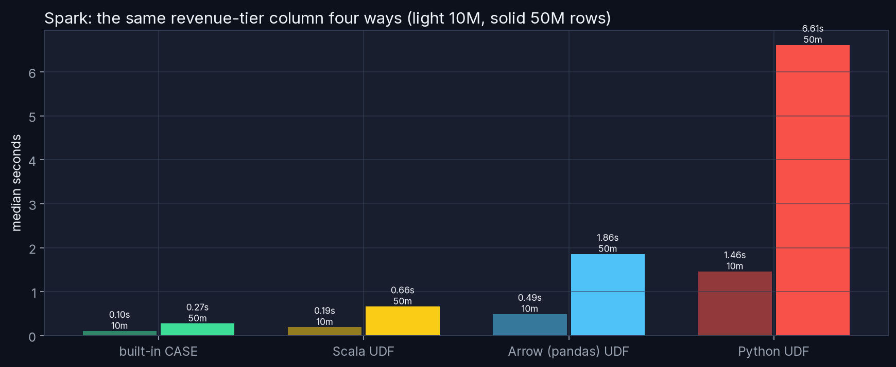
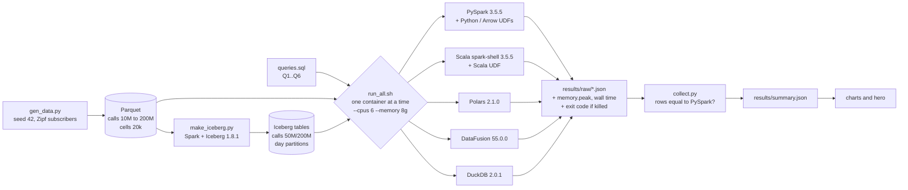

<p align="center"></p>

# MasterFabric Spark Rust Bench

The same six analytical SQL queries over the same synthetic telco call records, from 10M to
200M rows, run by **PySpark**, **Scala Spark**, **Polars**, **Apache DataFusion** and **DuckDB**,
each alone in a container with the same limits (6 CPU, 8 GiB). The data is read from a folder of
Parquet files and, at 50M and 200M rows, from an **Apache Iceberg** table written by Spark. Every
run's rows are checked against Spark's before any time counts: **234 of 234 query results are
identical** across 38 runs. Two runs did not finish (DataFusion at 200M rows, killed at the
memory limit); they are reported, not dropped.

It answers five questions an AI/data architect gets asked:

1. How much does Spark cost for jobs that fit on one machine, compared with single-node engines?
2. Is PySpark slower than Scala Spark?
3. What do UDFs cost, and which kind should a team allow?
4. How far does one node go, and how does the gap change from 10M to 200M rows?
5. Can single-node engines read the lakehouse's Iceberg tables, and does partitioning help them?

All numbers below were measured on one Apple M4 Pro laptop (Colima VM with 6 vCPUs, 10 GiB) and
are read from [`results/summary.json`](results/summary.json).

## Results

### Per-query medians

<p align="center"></p>
<p align="center"><em>Figure 1. Median of three timed runs after one first run, log scale, at 50M and 200M rows.
Polars and DuckDB lead on every query; Spark from Python and from Scala are within noise of each
other. DataFusion has no bars at 200M rows: it was killed at the 8 GiB limit.</em></p>

Median seconds at **200M rows** (4,150 MiB of Parquet):

| Query | PySpark | Scala Spark | Polars | DuckDB | DataFusion |
|---|---:|---:|---:|---:|---:|
| Q1 filter + aggregate | 1.457 | 1.450 | 0.454 | 0.389 | killed |
| Q2 high-cardinality group-by, top 100 | 1.774 | 1.631 | 0.400 | 0.551 | |
| Q3 join cells + daily aggregate | 3.736 | 3.720 | 1.307 | 1.334 | |
| Q4 count distinct subscribers per region | 4.603 | 4.624 | 1.319 | 1.314 | |
| Q5 window top-3 cells per region | 1.022 | 1.175 | 0.311 | 0.496 | |
| Q6 one week of 30 days, joined to cells | 3.383 | 3.322 | 0.534 | 0.693 | |
| **Sum** | **15.975** | **15.922** | **4.325** | **4.777** | |

At **50M rows** (1,038 MiB) the sums are 4.660 s (PySpark), 4.769 s (Scala), 1.103 s (Polars),
1.217 s (DuckDB) and 1.632 s (DataFusion). Spark's first run of a query is up to 3.2 times slower
than its median at 50M rows (PySpark Q1: 1.42 s first, 0.48 s median) and up to 2.1 times at 200M rows.
DuckDB's and DataFusion's first runs are within 10% of their medians; Polars' first runs of Q1
to Q3 are 2 to 3.4 times its medians.

### Scaling to 200M rows

<p align="center"></p>
<p align="center"><em>Figure 2. Left: sum of the six query medians as data grows (log-log). Right: peak
container memory; the X marks DataFusion's killed run at 200M rows, the dashed line the 8 GiB limit.</em></p>

| Rows (Parquet) | PySpark | Scala Spark | Polars | DuckDB | DataFusion | PySpark / Polars |
|---|---:|---:|---:|---:|---:|---:|
| 10M (207 MiB) | 1.545 s | 1.613 s | 0.260 s | 0.310 s | 0.293 s | 5.9x |
| 50M (1,038 MiB) | 4.660 s | 4.769 s | 1.103 s | 1.217 s | 1.632 s | 4.2x |
| 100M (2,075 MiB) | 9.067 s | 8.793 s | 2.146 s | 2.373 s | 2.896 s | 4.2x |
| 200M (4,150 MiB) | 15.975 s | 15.922 s | 4.325 s | 4.777 s | killed (exit 137) | 3.7x |
| Peak memory at 200M | 7.6 GiB | 7.1 GiB | 3.6 GiB | 3.2 GiB | 8 GiB (limit) | |

From 100M to 200M rows the single-node engines take 2.0 times as long and Spark 1.8 times: Spark's
fixed cost per query is a smaller share of a bigger job, so its gap narrows, slowly. DataFusion's
resident memory grows with each repeated query in one session (Q1 at 200M rows: 0.9, 1.7, 2.5,
3.3 GiB after runs 1 to 4), which ends the 200M-row run on Q3; a bounded spill pool and glibc
allocator settings did not change it ([ADR 0006](docs/adr/0006-scaling-to-200m-rows.md)). On the
host without a memory limit DataFusion finished 200M rows in 2.917 s.

### Iceberg reads

<p align="center"></p>
<p align="center"><em>Figure 3. The same queries on a folder of Parquet files (light) and on an Iceberg table
partitioned by day (solid). Q6 reads one week of 30 days; the last pair is Spark's Q6 written with
a TIMESTAMP_NTZ literal.</em></p>

Spark wrote the Iceberg tables (Iceberg 1.8.1, Hadoop catalog, partitioned by `day(start_ts)`):
30 files at 50M rows and 92 files (4,307 MiB) at 200M. PyIceberg's plan for Q6 keeps 7 of 30
and 20 of 92 files, 23% of the bytes, in 2.5 to 4.2 ms. Median seconds at 200M rows:

| | Parquet folder | Iceberg table |
|---|---:|---:|
| Q6, DuckDB (`iceberg_scan`) | 0.693 | 0.314 |
| Q6, Polars (`scan_iceberg`) | 0.534 | 0.349 |
| Q6, PySpark, portable `TIMESTAMP '...'` literal | 3.383 | 2.989 |
| Q6, PySpark, `TIMESTAMP_NTZ '...'` literal | 1.336 | 0.742 |
| Q1–Q5 sum (full scans), DuckDB | 4.084 | 4.068 |
| Q1–Q5 sum (full scans), Polars | 3.791 | 4.138 |
| Q1–Q5 sum (full scans), PySpark | 12.592 | 12.410 |

At 50M rows DataFusion read Iceberg too (through PyIceberg's file plan, since the native
`pyiceberg-core` provider is built for DataFusion 54, not 55): Q6 0.180 → 0.108 s, but peak memory
3.5 → 7.3 GiB. Its 200M-row Iceberg run was killed like the Parquet one.

The `start_ts` column has no time zone, so Spark types it `TIMESTAMP_NTZ`; the portable zoned
literal makes Spark cast the column, and EXPLAIN shows the date range never reaches the Iceberg
scan. Written as `TIMESTAMP_NTZ`, the filter is pushed down and Q6 drops from 2.989 s to 0.742 s
([ADR 0005](docs/adr/0005-iceberg-reads-from-single-node-engines.md)).

### Whole run and memory

<p align="center"></p>
<p align="center"><em>Figure 4. Left: host-measured wall time for the whole container run (start, six queries
four times, and for Spark the UDF queries). Right: peak container memory from cgroup memory.peak.</em></p>

| | PySpark | Scala Spark | Polars | DuckDB | DataFusion |
|---|---:|---:|---:|---:|---:|
| Peak memory, 10M rows | 4,000 MiB | 4,420 MiB | 889 MiB | 408 MiB | 1,653 MiB |
| Peak memory, 50M rows | 4,740 MiB | 5,833 MiB | 1,768 MiB | 1,290 MiB | 3,575 MiB |
| Engine start-up, in process | 2.1 s | 0.98 s (after JVM and shell) | 0.11 s | 0.07 s | 0.07 s |
| Whole container run, 50M rows | 63.8 s * | 31.0 s * | 5.7 s | 5.2 s | 6.8 s |

\* The Spark runs also execute their UDF variants (three for PySpark plus the NTZ Q6, one for
Scala), so the two Spark wall times are not comparable with each other; compare the SQL sums instead.

Reference, not part of the comparison: on the host with all 14 cores and no limits, the six
queries at 200M rows sum to 2.248 s (Polars), 2.421 s (DuckDB) and 2.917 s (DataFusion).

### Spark UDFs

<p align="center"></p>
<p align="center"><em>Figure 5. The same revenue-tier column, computed four ways and aggregated. Median seconds.</em></p>

| Revenue tier as | 10M rows | 50M rows | 100M rows | 200M rows |
|---|---:|---:|---:|---:|
| Built-in `CASE WHEN` | 0.111 | 0.263 | 0.482 | 0.846 |
| Scala UDF | 0.191 | 0.666 | 1.243 | 2.009 |
| Arrow (pandas) UDF | 0.459 | 1.810 | 3.569 | 6.835 |
| Python UDF (row at a time) | 1.448 | 6.594 | 13.681 | 24.754 |

### What this means

- For jobs that fit on one machine, Polars ran the same SQL **3.7x faster than PySpark at 200M
  rows** (5.9x at 10M) with **less than half the memory**; DuckDB was within 10% of Polars and used
  the least memory at every size. Neither needs a JVM or a cluster.
- **PySpark SQL is as fast as Scala SQL** (15.98 s vs 15.92 s at 200M rows). The plan runs in the
  JVM either way.
- **Python UDFs are the real cost:** 29x the built-in expression at 200M rows. Arrow UDFs cut that
  to 8x; a Scala UDF to 2.4x.
- **Single-node engines can read the lakehouse's Iceberg tables directly**, at the same cost as
  Parquet for full scans and 1.5 to 2.2x faster when the filter matches the partitioning.
  In Spark, check that filters actually reach the scan: a zoned literal on a zone-less column
  silently turns pruning off.
- **Memory decides where one node stops**, not speed: at 200M rows Spark used 7.6 of 8 GiB and
  DataFusion did not finish, while DuckDB and Polars stayed under 3.7 GiB.

## How it works

<p align="center"></p>
<p align="center"><em>Figure 6. One dataset as Parquet and as Iceberg, one SQL file, five engines in equally limited containers, one correctness gate.</em></p>



| Piece | What it does |
|---|---|
| [`bench/gen_data.py`](bench/gen_data.py) | Synthetic call records: subscriber (Zipf 1.3 over 2M IDs), cell (20,000), timestamp (30 days), data/voice/SMS, duration, MB, revenue in TRY; plus a `cells` dimension with 7 Turkish regions and technology. Snappy Parquet, 5M rows per file. |
| [`bench/queries.sql`](bench/queries.sql) | Six queries, one SQL text each, run unchanged on all engines. |
| [`bench/make_iceberg.py`](bench/make_iceberg.py) | Spark writes `calls_<size>` (partitioned by `day(start_ts)`) and `cells` as Iceberg tables in a Hadoop catalog under `data/iceberg`. |
| [`bench/iceberg_plan.py`](bench/iceberg_plan.py) | Plans the full scan and the Q6 scan with PyIceberg and counts files and bytes. |
| [`bench/run_pyspark.py`](bench/run_pyspark.py) | Spark `local[6]`, 6 GiB driver, 12 shuffle partitions, UTC; three UDF variants and Q6 with `TIMESTAMP_NTZ` literals; `FORMAT=iceberg` reads the Iceberg tables. |
| [`bench/RunSpark.scala`](bench/RunSpark.scala) | The same in Scala through `spark-shell -i`, plus a Scala UDF. |
| [`bench/run_python_engine.py`](bench/run_python_engine.py) | Polars (`SQLContext` over lazy scans), DataFusion (`SessionContext`) and DuckDB (views over `read_parquet`); with `iceberg`, `scan_iceberg`, PyIceberg's file plan and `iceberg_scan`. |
| [`bench/Dockerfile.engines`](bench/Dockerfile.engines) | The single-node engines image, with DuckDB's iceberg extension installed at build time. |
| [`bench/run_all.sh`](bench/run_all.sh) | Runs every engine in its own container, records cgroup peak memory, host wall time and the exit code of a failed run, then the Iceberg stage. |
| [`bench/collect.py`](bench/collect.py) | Builds `results/summary.json`, checks each run's rows against PySpark's, and lists failed runs and Iceberg plans. |
| [`tests/`](tests) | Polars, DataFusion and DuckDB agree on all six queries from Parquet and from an Iceberg table written in two snapshots; tolerance unit tests. |

Decisions are recorded as ADRs:

- [ADR 0001: How the benchmark stays fair](docs/adr/0001-benchmark-fairness.md)
- [ADR 0002: When to use Spark and when a single-node Rust engine](docs/adr/0002-spark-or-single-node-engine.md)
- [ADR 0003: Python in Spark is fine; Python UDFs are the cost](docs/adr/0003-python-udfs.md)
- [ADR 0004: DuckDB as a single-node engine next to Polars and DataFusion](docs/adr/0004-duckdb-as-a-single-node-engine.md)
- [ADR 0005: Reading Iceberg tables from single-node engines](docs/adr/0005-iceberg-reads-from-single-node-engines.md)
- [ADR 0006: What changes between 10M and 200M rows on one node](docs/adr/0006-scaling-to-200m-rows.md)

## Enterprise mapping

| Here | In a Cloudera / enterprise platform |
|---|---|
| Spark 3.5.5 in a container, `local[6]` | Spark on Cloudera Data Engineering (CDE) or CDP Private Cloud Base on YARN/Kubernetes, many executors |
| Parquet files in a folder | Iceberg tables on HDFS/Ozone or S3, shared by Spark, Impala and Trino (see [masterfabric-lakehouse-lab](https://github.com/masterfabric/masterfabric-lakehouse-lab)) |
| Polars / DuckDB / DataFusion in a container | A small-job path: containers on Kubernetes or Cloudera Machine Learning (CML) reading the same Iceberg tables |
| Iceberg tables in a Hadoop catalog (`data/iceberg`) | Iceberg tables registered in the Hive Metastore or a REST catalog; single-node readers then need the catalog endpoint and Ranger-governed credentials |
| `TIMESTAMP_NTZ` literal in Spark Q6 | Review rule for CDE Spark SQL: confirm with EXPLAIN that partition filters reach the Iceberg scan |
| `docker run --cpus --memory` | YARN queues or Kubernetes resource quotas |
| Spark UDF variants | Coding standards for CDE jobs: built-ins first, Arrow UDFs in Python, Scala for hot paths |
| Not measured: Rust inside Spark | Apache DataFusion Comet or Apache Gluten (Velox) as native Spark accelerators; Ballista for distributed DataFusion |

## Quickstart

Needs Docker (any runtime with at least 6 CPUs and 10 GiB), [uv](https://github.com/astral-sh/uv)
and about 13 GiB of disk (7.3 GiB of Parquet, 5.4 GiB of Iceberg tables).

```bash
git clone https://github.com/masterfabric/masterfabric-spark-rust-bench
cd masterfabric-spark-rust-bench
make venv                 # Python 3.12 + pinned requirements
make gen                  # 10M and 50M rows into data/ (about 1.2 GiB)
make gen-large            # 100M and 200M rows (about 6.2 GiB, 75 s here)
docker pull tabulario/spark-iceberg:3.5.5_1.8.1
make image                # Polars + DataFusion + DuckDB image (mf-srb/engines:2)
make bench                # five engines, four sizes, Iceberg at 50M and 200M: about 17 minutes here
make collect test charts  # summary.json, correctness tests (9), images
```

`SIZES=10m ICEBERG_SIZES=10m make bench` is a quick run on the smallest size; `ENGINES`,
`ICEBERG_ENGINES` and `HOST=0` narrow it further. `make clean-containers` removes any leftover
`mf-srb-*` containers if a run is interrupted.

## Limitations

- **One machine, single-node Spark.** Spark runs in `local[6]` mode, not on a cluster. The
  results say nothing about multi-node shuffles, executor failures or terabyte inputs, which is
  where Spark is built to win. 200M rows is the largest size measured; the trend in Figure 2
  should not be extrapolated to a cluster.
- **DataFusion's memory growth is measured, not explained.** Resident memory grows with each
  repeat of a query in one session; glibc allocator settings and a 4 GiB spill pool did not change
  it. With a fresh session per query it might finish 200M rows; that was not run.
- **Iceberg in a Hadoop catalog, append-only.** No REST or Hive catalog, no delete files, no
  schema evolution, no compaction. DataFusion reads Iceberg through PyIceberg's file plan, not a
  native reader, and refuses tables with delete files.
- **Warm cache.** The OS page cache holds the Parquet files after the first run; the medians
  measure compute, not storage I/O. The first-run column in `summary.json` is closer to a cold job.
- **Single-node engines through Python.** Polars, DataFusion and DuckDB are driven from their
  Python bindings (the execution is native); no standalone binary was benchmarked.
- **Three timed runs per query, one session per configuration.** Enough to see 2x differences;
  treat gaps under about 10% as noise.
- **Synthetic, skewed data.** The distributions are made up to be realistic in shape (Zipf
  subscribers, mostly data sessions), not taken from a real network. Rows are in random time
  order, so plain Parquet statistics cannot skip anything for Q6; data sorted by time would
  narrow the Parquet vs Iceberg gap.
- **Default tuning.** Spark got sensible local settings (12 shuffle partitions, 6 GiB driver),
  not per-query tuning; adaptive query execution is on by default in 3.5. Polars, DataFusion and
  DuckDB ran with defaults.
- **Containers on macOS** run inside a Linux VM (Colima, 6 vCPUs), which adds some overhead to
  all engines equally.
- Comet, Gluten and Ballista are mentioned as options, not measured.

## Roadmap

- Repeat on a 3-node Spark cluster with the same queries at 500M+ rows to find the crossover point.
- Add Apache DataFusion Comet as a Spark plug-in and measure it on the same SQL.
- Read the Iceberg tables through a REST catalog, after row-level deletes and compaction.
- Isolate DataFusion's memory growth (one session per query, other allocators) and report it upstream if it reproduces.
- Cold-cache runs (drop caches between runs) and more repeats.

## Related MasterFabric repositories

[lakehouse-lab](https://github.com/masterfabric/masterfabric-lakehouse-lab) ·
[realtime-telco](https://github.com/masterfabric/masterfabric-realtime-telco) ·
[airflow-mlops](https://github.com/masterfabric/masterfabric-airflow-mlops) ·
[onprem-llm-stack](https://github.com/masterfabric/masterfabric-onprem-llm-stack) ·
[llm-serving-bench](https://github.com/masterfabric/masterfabric-llm-serving-bench) ·
[secure-data-ai](https://github.com/masterfabric/masterfabric-secure-data-ai) ·
[genai-foundations](https://github.com/masterfabric/masterfabric-genai-foundations)

## License

Copyright (c) 2026 MasterFabric. Licensed under the [GNU Affero General Public License v3.0](LICENSE)
with the attribution and trademark terms in [NOTICE](NOTICE). Third-party components keep their own
licenses, listed in NOTICE. See also [CONTRIBUTING](CONTRIBUTING.md), [CODE_OF_CONDUCT](CODE_OF_CONDUCT.md)
and [SECURITY](SECURITY.md). Build history: [docs/TIMELINE.md](docs/TIMELINE.md).
